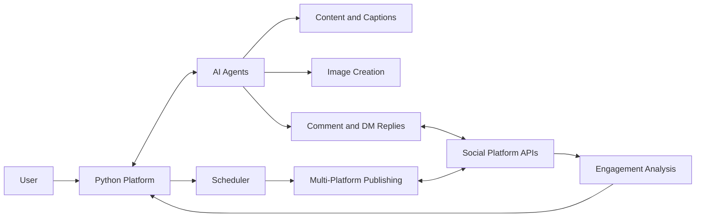

# AI Social Media Automation Platform

An AI platform that automates social media content creation, publishing, replies and engagement analysis.

> **Note:** This is a client/private project. Source code is not public; this page summarizes the work.

## Overview

The AI Social Media Automation Platform covers the whole social media workflow. It generates content and captions, creates images, schedules and publishes posts across multiple platforms, replies to comments and DMs with AI, and analyzes engagement.

## Key features

- **Content generation**: AI-written post content
- **Captions**: automatically generated captions
- **Image creation**: AI-generated images for posts
- **Scheduling**: plan posts ahead of time
- **Multi-platform publishing**: publish to several social platforms from one place
- **AI comment and DM replies**: automated, AI-generated responses to comments and direct messages
- **Engagement analysis**: review how content performs

## Tech stack

- **AI:** AI agents, LLM-based content generation
- **Language:** Python
- **Integration:** social platform API integration

## Architecture

## My role

- Engineered the AI platform
- Built the AI agent workflows for content, captions, images and comment/DM replies
- Implemented the API integrations for scheduling, multi-platform publishing and engagement analysis

## Screenshots / demo

_Screenshots coming soon. A live walkthrough is available on request._

## Contact

